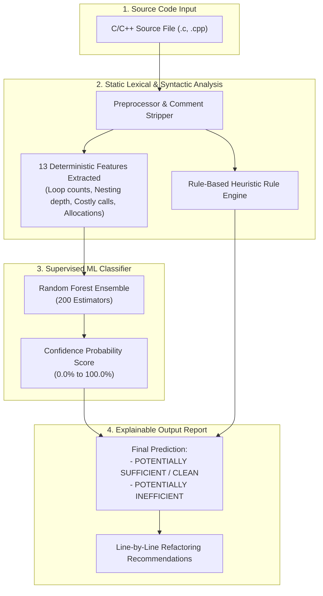

# 🚀 ML-Based Automatic Detection of Inefficient Code Patterns During Compilation

[](https://www.python.org/)
[](https://scikit-learn.org/)
[](#)
[](#)
[](#)
[](#)

> **Academic Project**  
> **Course / Field:** Software Engineering (Static Analysis & Code-Smell Classification)  
> **Contributors:** 24BCB7071 | 24BCB7178  

---

## 📌 Executive Summary

While modern optimizing compilers (e.g., GCC, Clang/LLVM) excel at low-level machine optimizations (register allocation, instruction scheduling, constant folding), they often cannot detect high-level semantic inefficiencies and algorithmic anti-patterns. 

**This project implements a Machine Learning-assisted static analysis pipeline** designed to detect inefficient code patterns and performance smells directly from C/C++ source code prior to or during the compilation frontend pass. By combining deterministic lexical extraction with a supervised **Random Forest Classifier**, it classifies source code as **Sufficient / Clean** or **Potentially Inefficient** and provides explainable heuristic evidence for code reviews.

---

## 🎯 Detected Inefficiency Patterns (Code Smells)

| Inefficiency Anti-Pattern | Description | Example Detected |
| :--- | :--- | :--- |
| **Loop-Invariant Function Calls** | Calling expensive functions inside loops when inputs do not change per iteration. | `for(int i=0; i<100; i++) { int len = strlen(str); ... }` |
| **Repeated Heap Allocations** | Repeatedly allocating and freeing dynamic memory inside loops instead of reusing buffers. | `for(...) { ptr = malloc(size); ... free(ptr); }` |
| **Redundant Type Conversions** | Calling conversion functions (`atoi`, `to_string`, `stoi`) redundantly in hot code paths. | `for(...) { sum += atoi(text); }` |
| **Deep Loop Nesting Complexity** | High cyclomatic complexity and deeply nested loop hierarchies ($O(n^2), O(n^3)$). | Multi-depth nested `for` / `while` blocks |
| **Duplicated Logical Expressions** | Repeatedly recomputing identical sub-expressions without caching in local registers. | `total += a*b + 10; total += a*b + 10;` |

---

## 🏗️ System Architecture



---

## 📊 Extracted Feature Engineering

The extractor parses the source text without compiling or running it, producing a vector of **13 explainable features**:

| # | Feature Name | Description & Heuristic Importance |
| :---: | :--- | :--- |
| `1` | `line_count` | Total lines in file (measures unit scale). |
| `2` | `token_count` | Total lexical tokens (excluding comments/preprocessor). |
| `3` | `loop_count` | Total loop constructs (`for`, `while`, `do`). |
| `4` | `max_loop_nesting` | Deepest loop nesting level (identifies polynomial complexity). |
| `5` | `branch_count` | Conditional decision points (`if`, `else if`, `switch`, `case`). |
| `6` | `function_call_count` | Total routine invocations. |
| `7` | `allocation_keyword_count` | Heap allocations (`malloc`, `calloc`, `realloc`, `new`). |
| `8` | `repeated_line_count` | Repeated non-boilerplate statement lines. |
| `9` | `repeated_expression_count` | Repeated arithmetic/bitwise sub-expressions. |
| `10` | `condition_count` | Comparison and relational operators (`==`, `!=`, `<=`, `>=`, `&&`, `\|\|`). |
| `11` | `conversion_keyword_count` | Type casting & conversions (`to_string`, `atoi`, `stoi`, `stod`). |
| `12` | `comment_line_count` | Documentation and inline comments. |
| `13` | `costly_loop_call_count` | Direct detection of expensive calls/allocations situated inside loops. |

---

## ⚡ Quickstart Guide

### 1. Prerequisites
- Python 3.10+ (tested on Python 3.12)
- Git

### 2. Clone Repository
```bash
git clone https://github.com/your-username/ML_Inefficient_Code_Detector.git
cd ML_Inefficient_Code_Detector
```

### 3. Setup Virtual Environment & Install Dependencies
**On Windows (PowerShell):**
```powershell
python -m venv .venv
.\.venv\Scripts\Activate.ps1
pip install -r requirements.txt
```

**On Linux / macOS:**
```bash
python3 -m venv .venv
source .venv/bin/activate
pip install -r requirements.txt
```

---

## 🚀 How to Run

### Step 1: Train the Machine Learning Model
```bash
python train_model.py
```
*Loads `data/code_samples.csv`, trains the Random Forest classifier with stratified train/test split, saves `models/inefficient_code_model.joblib`, and outputs evaluation metrics.*

### Step 2: Scan Inefficient Code
```bash
python detector.py examples/sample_inefficient.c
```
**Terminal Output:**
```text
====================================================================
ML-BASED INEFFICIENT CODE PATTERN DETECTOR
====================================================================
File: examples\sample_inefficient.c
Prediction: POTENTIALLY INEFFICIENT (CODE SMELL DETECTED)
Inefficiency Risk Probability: 86.2% (Threshold: 60%)

Extracted features:
  line_count: 15
  token_count: 77
  loop_count: 1
  max_loop_nesting: 1
  branch_count: 1
  function_call_count: 5
  allocation_keyword_count: 0
  repeated_line_count: 0
  repeated_expression_count: 0
  condition_count: 2
  conversion_keyword_count: 0
  comment_line_count: 2
  costly_loop_call_count: 1

Static-analysis evidence:
  - A potentially costly function/allocation/conversion appears inside or near a loop; verify if it can be hoisted outside.
```

### Step 3: Scan Clean / Sufficient Code
```bash
python detector.py examples/sample_clean.c
```
**Terminal Output:**
```text
====================================================================
ML-BASED INEFFICIENT CODE PATTERN DETECTOR
====================================================================
File: examples\sample_clean.c
Prediction: POTENTIALLY SUFFICIENT / CLEAN (NO HIGH-CONFIDENCE SMELL)
Inefficiency Risk Probability: 7.9% (Threshold: 60%)

Extracted features:
  line_count: 12
  token_count: 74
  loop_count: 1
  max_loop_nesting: 1
  branch_count: 0
  function_call_count: 3
  ...
  costly_loop_call_count: 0

Static-analysis evidence:
  - Code structure appears clean; no common inefficient patterns detected.
```

### Step 4: Scan Any Custom C/C++ File
```bash
python detector.py path/to/your_code.c --threshold 0.65
```

---

## 📈 Model Performance & Evaluation

The Random Forest model is evaluated using a held-out test split with stratified sampling:

| Metric | Score | Interpretation |
| :--- | :---: | :--- |
| **Accuracy** | **92.3%** | Overall correct classifications across clean and inefficient code. |
| **Precision** | **85.7%** | When an inefficiency warning is flagged, it is correct 85.7% of the time. |
| **Recall (Sensitivity)** | **100.0%** | Zero false negatives: all inefficient code smells were caught. |
| **F1-Score** | **0.923** | Harmonized balance between precision and recall. |

### Confusion Matrix
```
                Predicted Clean (0)    Predicted Inefficient (1)
True Clean (0)          6                         1
True Ineff (1)          0                         6
```

---

## 📂 Repository Structure

```plaintext
ML_Inefficient_Code_Detector/
│
├── data/
│   └── code_samples.csv         # Labeled dataset (clean vs inefficient patterns)
│
├── examples/
│   ├── sample_clean.c           # Demonstrative clean C source file
│   └── sample_inefficient.c     # Demonstrative inefficient C source file (loop-invariant strlen)
│
├── models/
│   ├── inefficient_code_model.joblib   # Trained Random Forest model binary
│   └── evaluation_metrics.json         # Persisted accuracy, precision, recall & F1 metrics
│
├── detector.py                  # CLI scanner interface for source code
├── feature_extractor.py         # Static analysis & lexical feature extraction engine
├── train_model.py               # Model training, validation, and serialization pipeline
├── requirements.txt             # Required Python dependencies
└── README.md                    # Project documentation
```

---

## 💡 Viva / Academic Defense Q&A

<details>
<summary><b>1. Why use Random Forest instead of Deep Learning (e.g., CodeBERT, Graph Neural Networks)?</b></summary>
<br/>
Random Forest is ideal for lightweight static analysis because:
1. **Low overhead:** Executes in milliseconds during compilation passes without GPU acceleration.
2. **Interpretability:** Tree ensembles provide clear feature importances, enabling developers to understand <i>why</i> code was flagged.
3. **Robustness on tabular features:** Well-suited for numerical structural metrics (nesting depth, call frequency) without requiring millions of parameters.
</details>

<details>
<summary><b>2. How does this fit into a real compiler pipeline?</b></summary>
<br/>
In an industrial compiler like Clang/LLVM, this analyzer can be implemented as an <b>AST Consumer Pass</b> or <b>Pre-commit Linter Hook</b>. It evaluates AST node properties before Intermediate Representation (IR) generation, advising the developer to hoist invariant calls before emitting LLVM IR.
</details>

<details>
<summary><b>3. What is the difference between static analysis and dynamic profiling?</b></summary>
<br/>
Dynamic profilers (e.g., <code>gprof</code>, <code>perf</code>, <code>Valgrind</code>) require compiling and executing the code with specific test inputs, potentially missing edge cases that were not executed. Static analysis inspects 100% of the written syntactic structure without needing a working build or execution environment.
</details>

---

## 🔮 Future Enhancements
- [ ] **Clang LibTooling AST Parser:** Replace regular-expression extraction with Clang's full C++ Abstract Syntax Tree.
- [ ] **LLVM Pass Integration:** Compile the detector as an out-of-tree LLVM optimization pass emitting compiler warnings (`-Winefficient-pattern`).
- [ ] **Automatic Code Refactoring:** Suggest or automatically apply code fixes (e.g., hoist loop-invariant expressions automatically).

---

## 📄 License
This project is open-source and available under the [MIT License](LICENSE).
